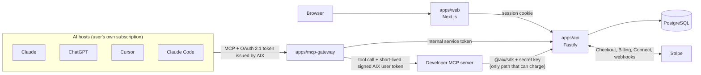
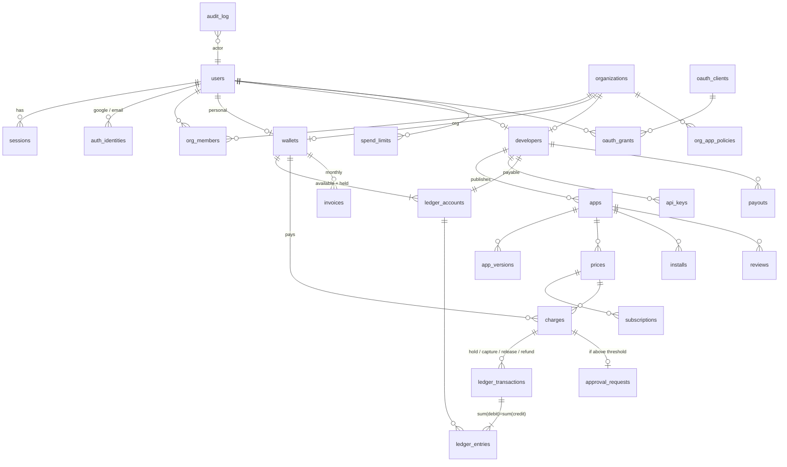
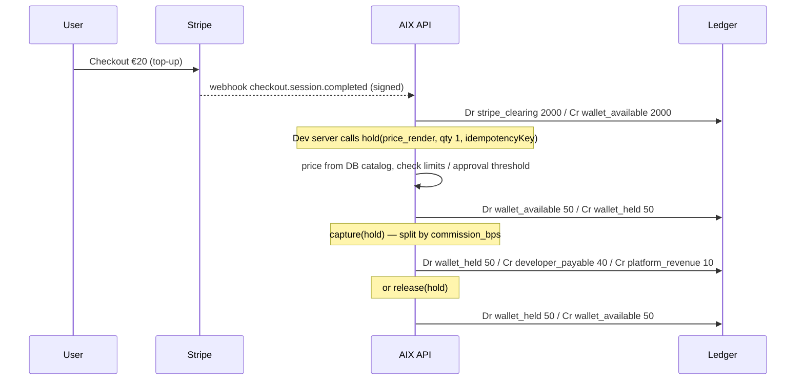
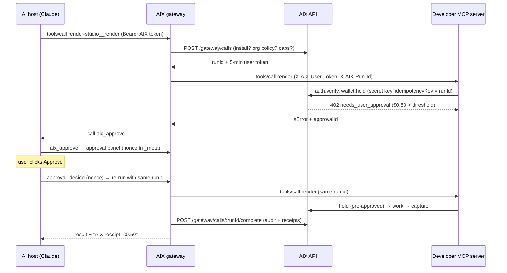

# AIX architecture

## 1. Repo structure

```
.
├── SPEC.md                    # product spec (source of truth)
├── apps/
│   ├── web/                   # Next.js App Router + Tailwind — store, wallet, dev portal, org admin, internal admin
│   ├── api/                   # Fastify REST API — auth, OAuth 2.1 provider, wallet, charges, apps, Stripe webhooks
│   │   └── src/jobs/          # payout + invoice jobs, run as CLI scripts (cron in prod)
│   └── mcp-gateway/           # marketplace MCP server (Streamable HTTP), proxies installed apps' tools
├── packages/
│   ├── core/                  # pure domain logic: Money, ledger posting rules, commission split, limits (no I/O)
│   ├── db/                    # Drizzle schema, migrations, client, seed script
│   ├── manifest/              # Zod schema + validator for aix.json
│   ├── sdk/                   # @aix/sdk — developer server SDK
│   └── cli/                   # `aix` CLI
├── templates/                 # prompt | server | local | web starter apps (server = MCP + paid tool + UI panel)
├── marketplace/               # generated Claude Code plugin marketplace (.claude-plugin/marketplace.json)
├── docs/                      # architecture, decisions, open questions, running locally
├── docker-compose.yml         # Postgres
└── turbo.json / pnpm-workspace.yaml / tsconfig.base.json
```

One addition to the spec's package list: **`packages/core`**. Ledger posting and commission math are the most
safety-critical code in the system; keeping them pure (no DB, no HTTP) makes them trivially unit- and
property-testable and shareable between the API and the jobs.

## 2. Components and trust boundaries



Key rules visible in the diagram:
- Hosts only ever hold an **AIX-issued** OAuth token. AIX never sees host credentials (hard rule 1).
- The gateway can *create approval requests* and *read* balances, but **only a developer secret key** can
  create holds/captures (hard rule 3). Browser code never calls charge endpoints.
- The developer server receives a short-lived (≈5 min) signed **AIX user token** (JWT, audience = app id)
  that it verifies with `aix.auth.verify`.

## 3. Data model



### Tables from the spec (key fields)

| Table | Key fields / notes |
|---|---|
| `users` | id (uuid), email (unique, citext), name, created_at |
| `organizations` | id, name, slug |
| `org_members` | org_id, user_id, role `owner\|admin\|billing\|member` |
| `wallets` | id, owner_user_id **xor** owner_org_id (CHECK), currency `EUR` |
| `ledger_accounts` | id, kind, wallet_id / developer_id (nullable), currency, normal_balance `debit\|credit` |
| `ledger_entries` | id, transaction_id, account_id, direction `debit\|credit`, amount_cents **bigint > 0** |
| `developers` | id, user_id xor org_id, stripe_connect_account_id, payout_status |
| `apps` | id, slug, name, developer_id, type, status, **commission_bps** (default 2000 = 20%) |
| `app_versions` | id, app_id, semver, manifest jsonb, package_url, package_sha256, signature, review_status, review_notes |
| `prices` | id (`price_…`), app_id, kind, unit, unit_amount_cents, interval, included_units, stripe_price_id, active |
| `installs` | id, user_id / org_id, app_id, app_version_id, granted_permissions jsonb |
| `subscriptions` | id, payer wallet, price_id, stripe_subscription_id, status, current_period_end |
| `charges` | id, app_id, wallet_id, price_id, quantity, amount_cents, currency, idempotency_key, run_id, status `held\|captured\|refunded\|failed\|released`, **hold_expires_at** |
| `spend_limits` | scope (user / org_member / app), period `daily\|monthly`, cap_cents, auto_approve_threshold_cents |
| `api_keys` | id, developer_id, prefix (shown), hash (sha256), scopes[], last_used_at, revoked_at |
| `oauth_clients` / `oauth_grants` | MCP hosts + "Sign in with AIX" clients; grants store hashed codes/tokens only |
| `org_app_policies` | org_id, app_id, allowed, allowed_roles[], max_permissions jsonb |
| `audit_log` | id, actor, org_id, action, target, metadata jsonb (never conversation content), created_at |

### Additions (and why)

| Addition | Why |
|---|---|
| `ledger_transactions` | Groups the entries of one money movement; invariant "debits = credits" is checked per transaction (DB trigger + app code). Holds `kind`, `charge_id`, `external_ref` (Stripe id). |
| Two ledger accounts per wallet: `wallet_available` and `wallet_held` | A **hold** is a real ledger movement available → held. Capture moves held → developer payable + platform revenue; release moves held → available. Balances stay derived; no "reserved" column to drift. |
| `charges.idempotency_key` UNIQUE per (app_id, key), `charges.status = released` | Hard rule 5; "released" distinguishes a never-captured hold from a refund of a captured charge. |
| `charges.hold_expires_at` | Uncaptured holds auto-release so money can't be stuck forever. |
| `apps.commission_bps` | "Commission rate configurable per app", as integer basis points (no floats). |
| `prices.included_units`, `stripe_price_id` | Free units and mirroring of subscription prices into Stripe Billing. |
| `sessions`, `auth_identities`, `magic_link_tokens` | User auth (tokens stored hashed). |
| `approval_requests` | Pending "This costs €0.50 — approve?" decisions, with expiry; referenced by `NeedsUserApproval.approvalUrl`. |
| `usage_records` | Batched `aix.usage.report()` units before they become charges. |
| `stripe_events` | Webhook event ids, processed once (webhook idempotency). |
| `payouts`, `invoices` | Payout statements and monthly user invoices (PDF url). |
| `reviews` | Store ratings/reviews on the app page. |
| `encrypted_secrets` | Developer-provided third-party API keys, AES-256-GCM, key from env. |

### Ledger account kinds

| kind | normal balance | owner |
|---|---|---|
| `wallet_available` | credit (liability: we owe the user) | wallet |
| `wallet_held` | credit | wallet |
| `developer_payable` | credit | developer |
| `platform_revenue` | credit | platform (singleton) |
| `stripe_clearing` | debit (asset: money at Stripe) | platform |
| `refunds_payable` | credit | platform — card refunds in flight |
| `payouts_clearing` | debit | platform — Connect transfers in flight |

Balance of an account = Σ(entries on its normal side) − Σ(entries on the other side). Computed by query
(later: a cached, verifiable materialized view if needed). Ledger rows are **append-only** (UPDATE/DELETE
revoked from the app DB role).

## 4. Money flows



- **Subscription** (Stripe Billing on the payer's card): `invoice.paid` → Dr stripe_clearing / Cr developer_payable + platform_revenue.
- **Refund of a captured charge**: reversal transaction (Dr developer_payable + platform_revenue / Cr wallet_available). Never deletes rows.
- **Monthly payout**: per developer, balance of `developer_payable` → Stripe Connect transfer → Dr developer_payable / Cr payouts_clearing, then settled against stripe_clearing on confirmation; payout statement row.
- **Commission split rounding**: platform share = floor(amount × bps / 10000), developer gets the remainder — so the split always sums exactly and rounding favours the developer.

## 5. Request authentication matrix

| Caller | Credential | Can |
|---|---|---|
| Browser (web) | HttpOnly session cookie | read own data, top-up, approve/deny approvals, manage limits, install |
| AI host → gateway | AIX OAuth 2.1 access token (PKCE, audience = gateway) | tools on behalf of user |
| Gateway → API | internal service credential + user context | read balances/installs/policies, create approval requests, audit |
| Developer server → API | `sk_test_…` secret key (scoped) | verify user tokens, entitlements, **hold/capture/release**, usage |
| Stripe → API | webhook signature | top-ups, invoices, Connect events |

## 6. A paid tool call through the gateway


